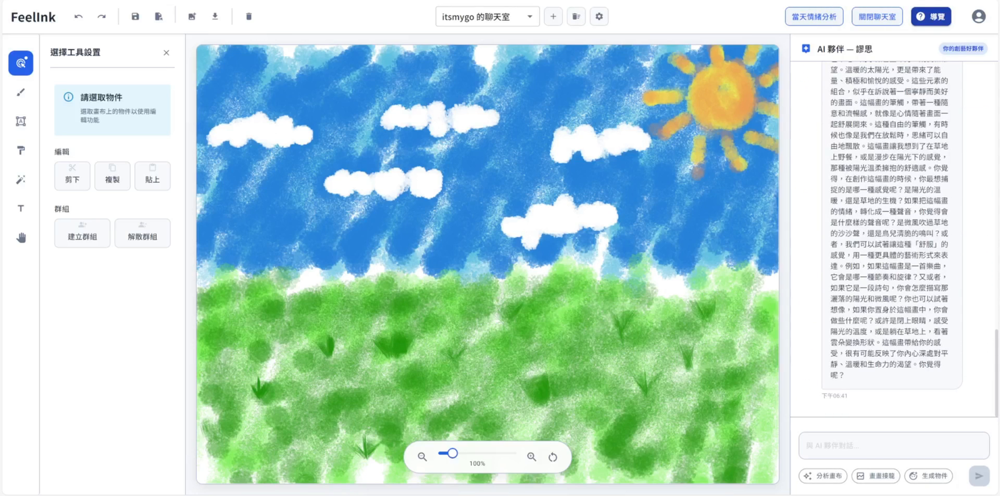
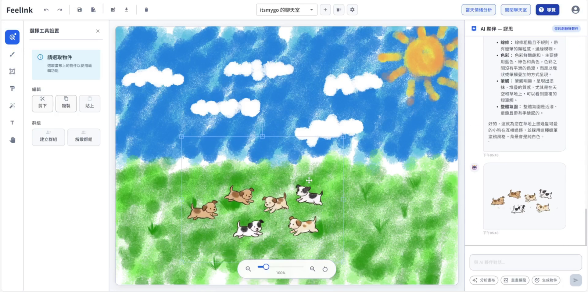
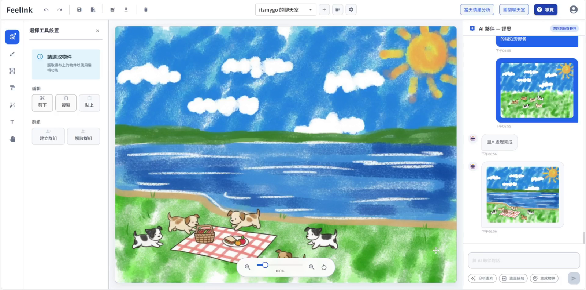
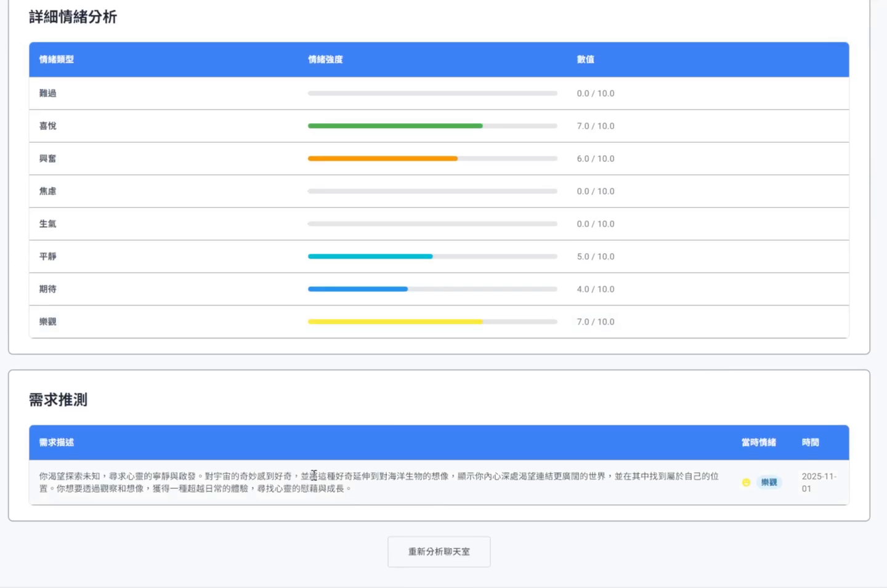
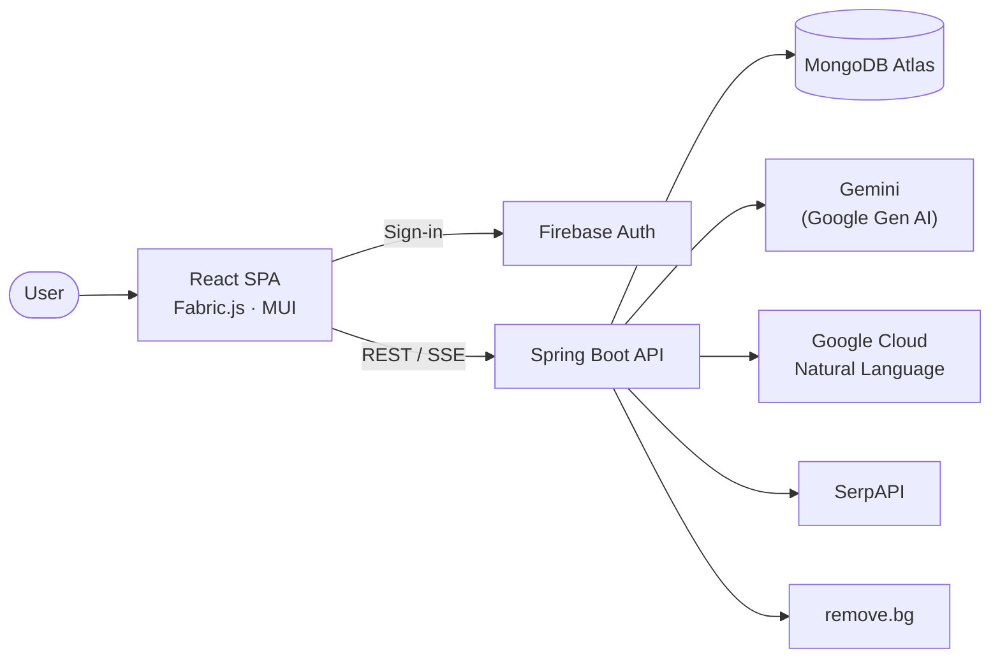

# FeelInk 超繪聊

**An AI emotional support platform that pairs drawing with empathetic AI chat.**

Draw and chat with an AI partner that reads your emotions and responds with care.

- 🏆 **3rd Place**, 30th InnoServe Awards (1,964 teams nationwide)
- 🏅 **Honorable Mention**, MOE Intelligent Innovation Contest (2025)
- 🏅 **Honorable Mention**, NTOU CSE Capstone Competition (2025)

> This is the **React frontend**. Backend: [feelink_backend](https://github.com/PeiJeSsu/feelink_backend)

---

## 🎬 Demo Video

[](https://youtu.be/wIL9Pozo4Vw)

*Click the image to watch the demo on YouTube.*

---

## 📸 Screenshots

> The app UI is in Traditional Chinese.

| AI partner reads the drawing and responds | AI generates objects onto the canvas |
|---|---|
|  |  |
| **Drawing relay: the AI continues the picture** | **Daily emotion report** |
|  |  |

---

## ✨ Features

### 🎨 Drawing
- Fabric.js tools: textured brushes, shapes, text, eraser, and paint bucket
- Adjustable color, size, and opacity; move, rotate, scale, group, undo, and redo
- Save and reopen canvases, or export them as files

### 💬 AI Partner
- Three AI partners with distinct personalities: warm, curious, and creative
- Replies stream in real time over Server-Sent Events, so there is no silent wait
- Multimodal input: the AI can analyze the canvas as well as the conversation

### 🖌️ AI-Assisted Creation
- **Analyze canvas**: reads colors, subjects, and composition to gauge mood
- **Generate objects**: the AI draws what you describe, background removed
- **Drawing relay**: the AI picks up the user's drawing and continues it

### 🛡️ Emotional Support
- **Crisis-aware replies**: a 5-level risk score decides when to offer hotlines
- **Real resources**: finds real counseling services via web search (SerpAPI)
- **Daily emotion report**: scores eight emotions and infers the user's needs

---

## 🏗️ Architecture



| Layer | Technology |
|---|---|
| Frontend | React 19, Material UI, Fabric.js, Recharts, React Router |
| Backend | Spring Boot 3, Java 17 |
| Database | MongoDB Atlas |
| Auth | Firebase Authentication (email/password and Google sign-in) |
| AI & APIs | Gemini, Google Cloud Natural Language, SerpAPI, remove.bg |
| Deployment | Vercel (frontend), Google Cloud Run (backend) |
| Testing & Quality | Jest, JUnit, SonarQube Cloud, GitHub Actions |

---

## ✅ Testing & CI/CD

- **1,300+ tests**: ~900 Jest (this repo) and 440 JUnit (backend)
- GitHub Actions runs all tests and SonarQube on every push and PR
- Workflows are in [`.github/workflows`](.github/workflows)

---

## 🚀 Getting Started

**Prerequisites:** Node.js 18+, a Firebase project, and a running [backend](https://github.com/PeiJeSsu/feelink_backend).

```bash
git clone https://github.com/PeiJeSsu/feelink_frontend.git
cd feelink_frontend
npm install
```

Create a `.env` file in the project root:

```env
REACT_APP_API_BASE_URL=http://localhost:8080
REACT_APP_FIREBASE_API_KEY=your-api-key
REACT_APP_FIREBASE_AUTH_DOMAIN=your-project.firebaseapp.com
REACT_APP_FIREBASE_PROJECT_ID=your-project-id
REACT_APP_FIREBASE_STORAGE_BUCKET=your-project.appspot.com
REACT_APP_FIREBASE_MESSAGING_SENDER_ID=your-sender-id
REACT_APP_FIREBASE_APP_ID=your-app-id
```

Then run:

```bash
npm start              # Start the dev server at http://localhost:3000
npm run test:coverage  # Run tests with a coverage report
```

---

## 👥 Team

Capstone project by a 4-person team at NTOU CSE, advised by Prof. Shang-Pin Ma.

**My role (Team Lead):**
- Led system architecture design and frontend–backend integration
- Designed the crisis-aware response flow
- Built real-time streaming chat over SSE
- Set up the CI/CD pipeline
